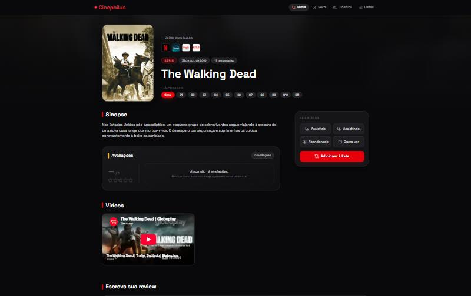
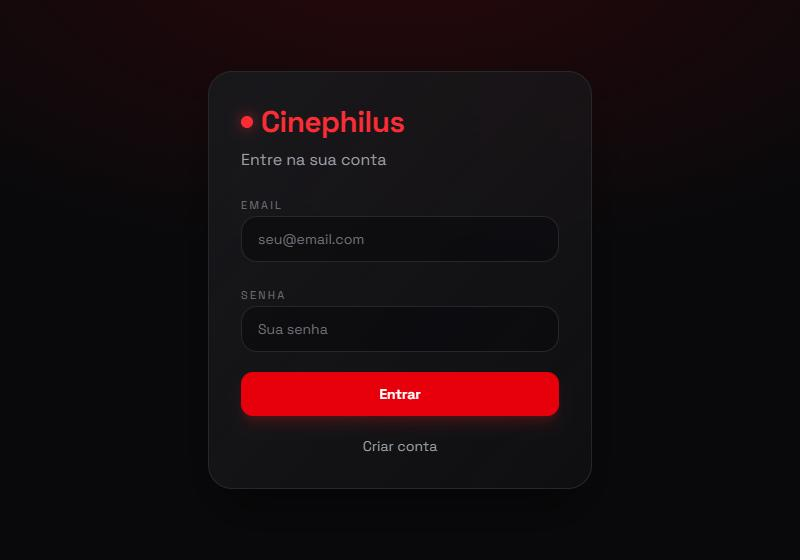
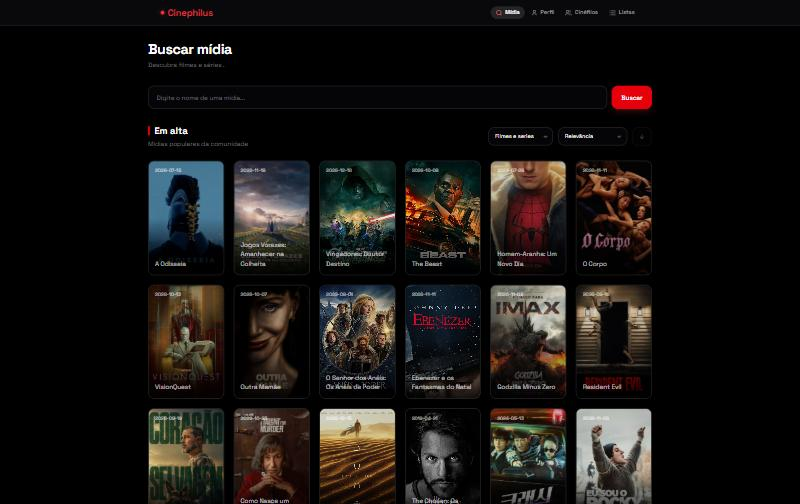
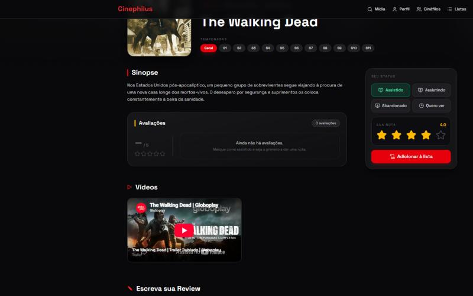
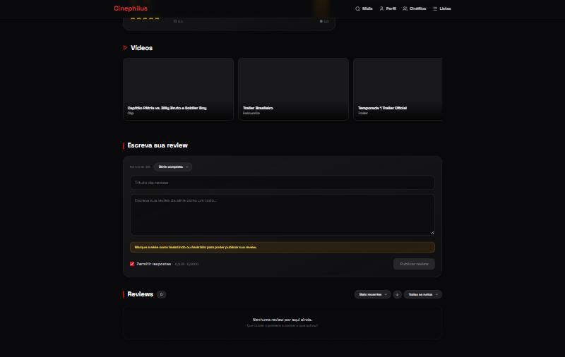
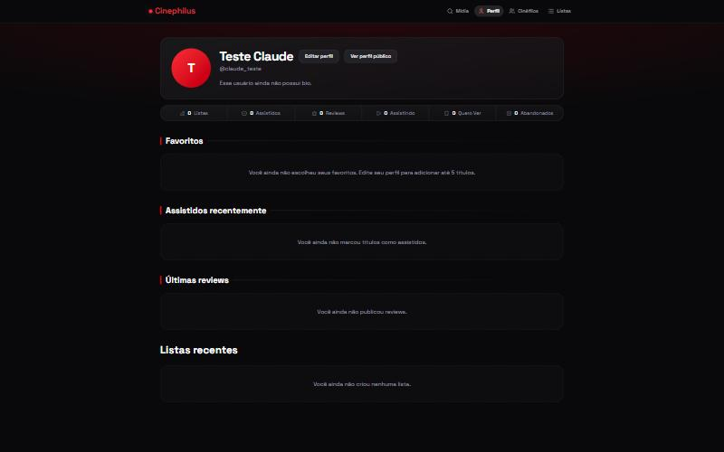
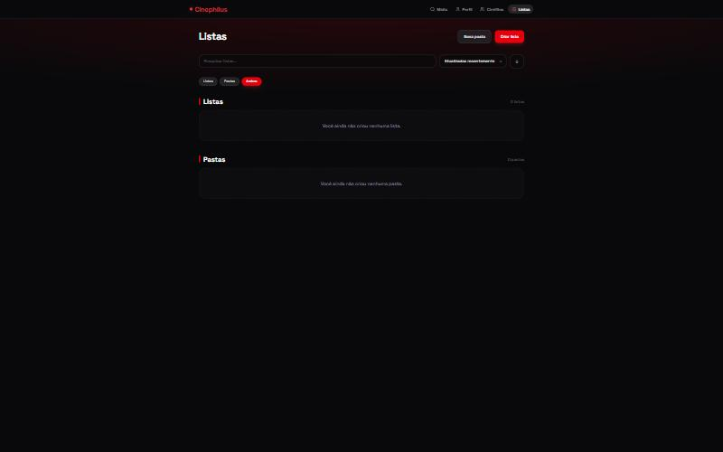
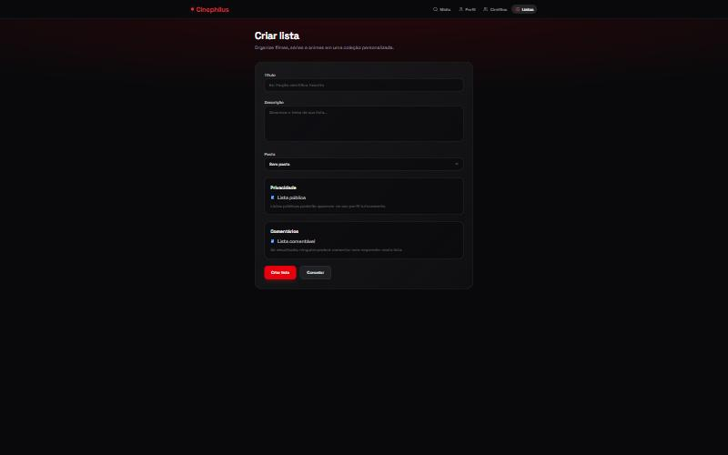
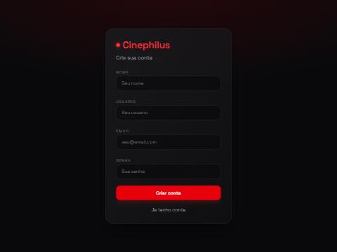
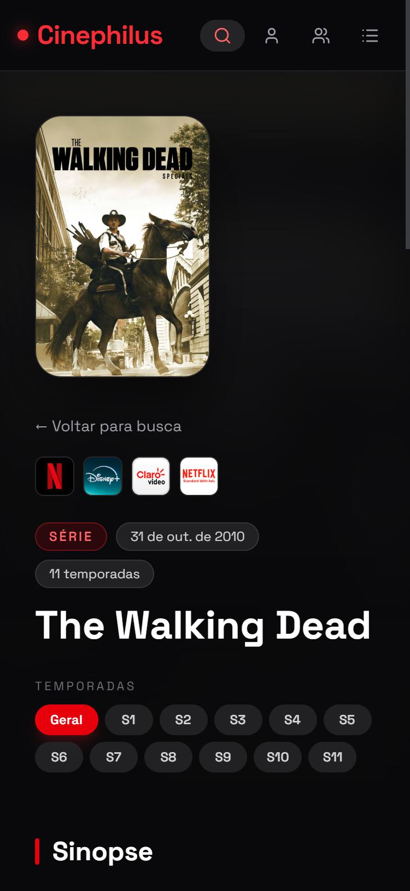

# Cinephilus

> Uma rede social para quem ama cinema e séries: descubra títulos, acompanhe o que você assiste, dê notas, escreva reviews e monte listas para compartilhar.



O Cinephilus usa a API do [TMDB](https://www.themoviedb.org/) para buscar filmes e séries, com pôsteres, sinopses, temporadas, trailers e onde assistir. Por cima disso, cada usuário tem seu próprio diário: marca o status de cada título, dá nota de meia em meia estrela, escreve reviews da série inteira ou de cada temporada e organiza tudo em listas e pastas.

---

## Funcionalidades

**Descoberta**
- Busca de filmes e séries, com uma vitrine "Em alta", filtros e ordenação
- Página de detalhes com pôster, sinopse, data, temporadas, trailers e as plataformas de streaming onde o título está disponível
- Em séries, cada temporada pode ser vista separadamente, com sinopse, pôster, notas e reviews próprios

**Acompanhamento**
- Status por título: *Assistido*, *Assistindo*, *Abandonado* e *Quero ver*
- Nota de 0,5 a 5 estrelas, com a média e a distribuição das notas da comunidade

**Reviews e conversa**
- Reviews da série completa ou de uma temporada específica
- Curtir e descurtir reviews
- Comentários com respostas em árvore, em reviews e em listas, que o autor pode desativar

**Listas e pastas**
- Listas públicas ou privadas, que podem ser organizadas em pastas
- Curtidas e comentários em listas públicas

**Perfis e comunidade**
- Perfil com foto, bio, até 5 favoritos, assistidos recentes, últimas reviews e estatísticas
- Perfil público para cada usuário em `/u/:username`
- Página **Cinéfilos** para encontrar outras pessoas

---

## Telas

| Login | Busca |
|---|---|
|  |  |

| Status e nota | Escrever review |
|---|---|
|  |  |

| Perfil | Listas |
|---|---|
|  |  |

| Criar lista | Cadastro | Celular |
|---|---|---|
|  |  |  |

---

## Stack

| Camada | Tecnologias |
|---|---|
| Frontend | React 19, Vite, React Router, Tailwind CSS 4, lucide-react |
| Backend | Node.js, Express 5, Sequelize, JWT (jsonwebtoken + bcrypt), Multer (upload de avatar) |
| Banco de dados | PostgreSQL |
| Dados externos | API do TMDB (via axios) |

### Estrutura

```
Cinephilus/
├── src/                  # API (Express)
│   ├── config/           # Conexão com o banco (Sequelize)
│   ├── controllers/      # Camada HTTP
│   ├── services/         # Regras de negócio e integração com o TMDB
│   ├── models/           # Modelos Sequelize
│   ├── routes/           # Rotas: /auth, /media, /users, /lists, /folders, /public
│   ├── middlewares/      # Autenticação JWT
│   └── server.js         # Ponto de entrada da API
├── frontend/             # SPA em React + Vite
│   └── src/
│       ├── pages/        # Telas
│       ├── components/   # Navbar, comentários em árvore
│       ├── services/     # Cliente da API (axios)
│       └── index.css     # Tema e classes visuais compartilhadas (ui-*)
├── uploads/              # Avatares enviados (ignorado pelo git)
└── docs/screenshots/     # Imagens deste README
```

---

## Como rodar localmente

### Pré-requisitos

- [Node.js](https://nodejs.org/) 20 ou mais recente
- [PostgreSQL](https://www.postgresql.org/) rodando localmente
- Um token da API do TMDB. Crie uma conta em themoviedb.org e copie o **API Read Access Token** em *Configurações → API*.

### 1. Banco de dados

Crie um banco vazio, por exemplo:

```bash
createdb -U postgres cinephilus
```

As tabelas são criadas e atualizadas automaticamente quando a API sobe (`sequelize.sync({ alter: true })`), então não é preciso rodar migrations nem seeds.

### 2. Variáveis de ambiente

Copie o arquivo de exemplo e preencha com os seus valores:

```bash
cp .env.example .env
```

| Variável | Descrição |
|---|---|
| `PORT` | Porta da API. Use `3000`, que é o endereço que o frontend espera. |
| `DB_HOST`, `DB_PORT`, `DB_NAME`, `DB_USER`, `DB_PASSWORD` | Conexão com o PostgreSQL |
| `JWT_SECRET` | Segredo para assinar os tokens de login |
| `TMDB_API_TOKEN` | API Read Access Token do TMDB |

### 3. Backend

Na raiz do projeto:

```bash
npm install
npm run dev     # com recarregamento automático (nodemon)
# ou
npm start
```

A API fica em **http://localhost:3000**.

### 4. Frontend

Em outro terminal:

```bash
cd frontend
npm install
npm run dev
```

Abra **http://localhost:5173**, crie uma conta e pronto.

### Resetar os dados

Para apagar todos os dados e começar do zero, pare a API e rode:

```bash
psql -U postgres -d cinephilus -c "DROP SCHEMA public CASCADE; CREATE SCHEMA public;"
```

Na próxima vez que a API subir, as tabelas são recriadas vazias. **Atenção:** isso apaga usuários, listas, reviews e comentários de forma permanente.

---

## Licença

Distribuído sob a licença MIT. Veja [LICENSE](LICENSE).
